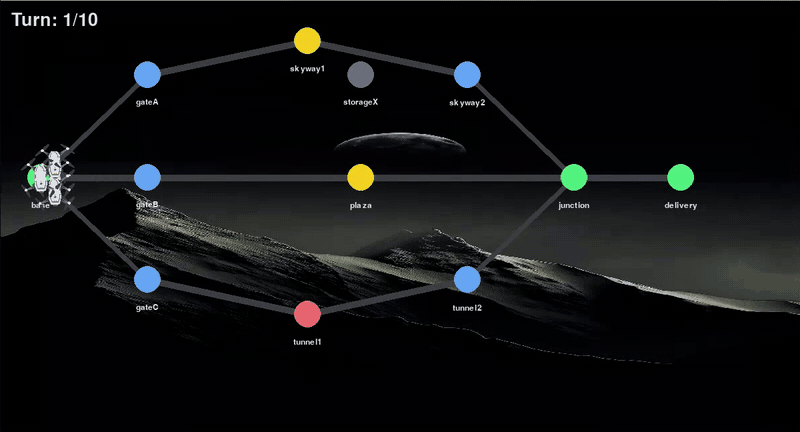
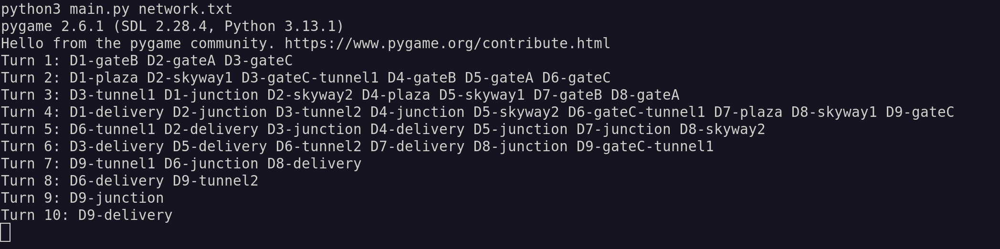

<p>
  
  
</p>
# Fly-in 🚁

**Autonomous Drone Fleet Routing Simulation**

## Description

Fly-in is a Python-based simulation that routes a fleet of autonomous drones through a network of interconnected zones, from a starting hub to a delivery destination, in the fewest possible turns.

The challenge goes beyond finding the shortest path: drones must share limited-capacity zones and connections while respecting movement costs, restricted areas, and scheduling constraints.

The project combines graph algorithms, object-oriented design, deterministic turn scheduling, and real-time visualization using Pygame.

## ✨ Features

- **Custom Graph Engine** — Builds and validates the network without external graph libraries.
- **Dijkstra’s Algorithm** — Finds minimum-cost routes across zones with different movement costs.
- **Yen’s K-Shortest Paths** — Discovers alternative loopless routes to distribute drones and reduce bottlenecks.
- **Capacity-Aware Scheduling** — Enforces zone occupancy and connection throughput limits.
- **Deterministic Movement** — Resolves competing drone movements in a predictable order.
- **Restricted-Zone Transit** — Handles zones that require two turns to cross.
- **Pygame Visualization** — Displays the network and animates drone movements in real time.
- **Input Validation** — Reports malformed network definitions with line-specific errors.

## 🚀 Quick Start

**Requirements:** Python 3.10+ and Pygame.

Install dependencies:

```bash
make install
```

Run the default map:

```bash
make run
```

Run a custom map:

```bash
python3 main.py maps/easy/02_simple_fork.txt
```

## 🧠 Routing & Simulation

Fly-in separates route calculation from turn-by-turn movement:

1. **Pathfinding** — Dijkstra computes minimum-cost routes; Yen’s algorithm identifies alternative paths.
2. **Route Distribution** — Drones can be distributed across distinct routes to reduce congestion.
3. **Turn Scheduling** — Drones are processed deterministically while zone and connection capacities are enforced.
4. **Movement & Transit** — Restricted-zone crossings take additional time, and drones wait when a move cannot be completed.
5. **Termination** — A safety turn limit protects against simulations that cannot make progress.

## 🗺️ Network Model

| Element | Purpose |
|---|---|
| `start_hub` / `end_hub` | Define the route origin and destination |
| `hub` | Represents a zone with coordinates and movement properties |
| `connection` | Links two zones and may impose a traversal capacity |
| `max_drones` | Limits the number of drones occupying a zone |
| `max_link_capacity` | Limits simultaneous use of a connection |

Zone types determine movement behavior: `normal`, `priority`, `restricted`, and `blocked`.

## 🏗️ Architecture

The simulation uses an object-oriented design to separate network data, route planning, and drone movement.

- **Zones and Connections** — Represent the network and its movement and capacity constraints.
- **Drones** — Track each drone’s progress through the network.
- **Routing Engine** — Calculates shortest and alternative paths.
- **Simulation Engine** — Schedules movements and enforces capacity limits.
- **Pygame Renderer** — Visualizes the network and animates each turn.

## 📁 Project Structure

```text
Fly-in/
├── maps/             # Network map definitions
├── main.py           # Application entry point
├── Makefile          # Build and development commands
└── README.md
```

## 🧰 Development Tools

- **Python 3.10+** — Core implementation
- **Dijkstra & Yen’s Algorithms** — Graph routing
- **Pygame** — Real-time visualization
- **heapq** — Priority queue for pathfinding
- **mypy & flake8** — Type checking and code quality

## 🔧 Development Commands

| Command | Description |
|---|---|
| `make install` | Install project dependencies |
| `make run` | Run the default simulation |
| `make debug` | Launch the debugger |
| `make lint` | Run linting and type checks |
| `make lint-strict` | Run strict type checking and linting |
| `make clean` | Remove cache directories |

